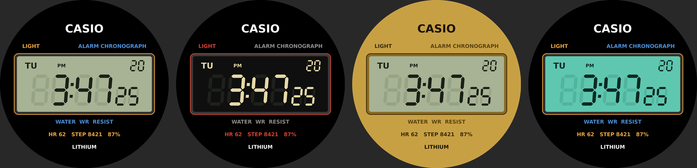

# Casio Retro – watch face Garmin

Quadrante Connect IQ in stile Casio digitale anni '80 (F-91W / A168) per Garmin Fenix.

## Caratteristiche
- Cifre LCD a 7 segmenti disegnate via codice (nessun font esterno), inclinate come sui Casio
- Segmenti spenti "fantasma" visibili, come su un vero LCD (disattivabili)
- Giorno della settimana, data, indicatore PM/24H, secondi piccoli accanto ai minuti
- Frequenza cardiaca, passi e batteria nella cassa
- 4 temi: Classico F-91W, Display negativo, Oro A168, Illuminator
- Always-on AMOLED con protezione burn-in (solo segmenti accesi, attenuati, spostati ogni minuto)
- Secondi aggiornati anche a basso consumo sui display MIP (`onPartialUpdate`)

## Compilazione
1. Installa il [Connect IQ SDK](https://developer.garmin.com/connect-iq/sdk/) e l'estensione Monkey C per VS Code.
2. Nell'SDK Manager scarica il device **Fenix 9**.
3. In VS Code: `Monkey C: Edit Products` e spunta il Fenix 9 (aggiorna `manifest.xml`).
   Nel manifest ci sono già le varianti Fenix 8 come base.
4. `Monkey C: Build for Device` → copia il `.prg` in `GARMIN/APPS` sull'orologio via USB,
   oppure prova nel simulatore con `Monkey C: Run`.

I temi si cambiano dall'app Connect IQ sul telefono (impostazioni del quadrante).

`preview/` contiene immagini generate in Python che replicano la stessa geometria del codice.
